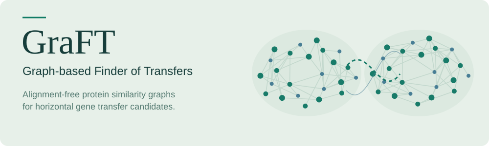
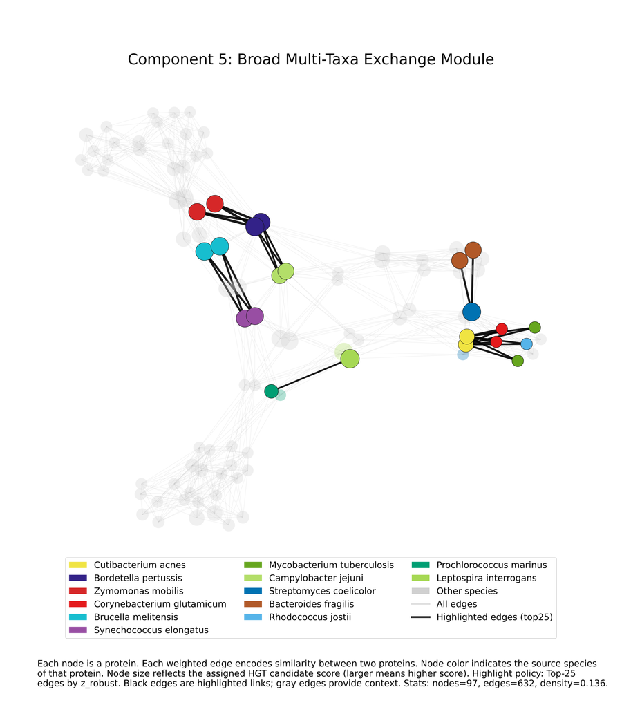
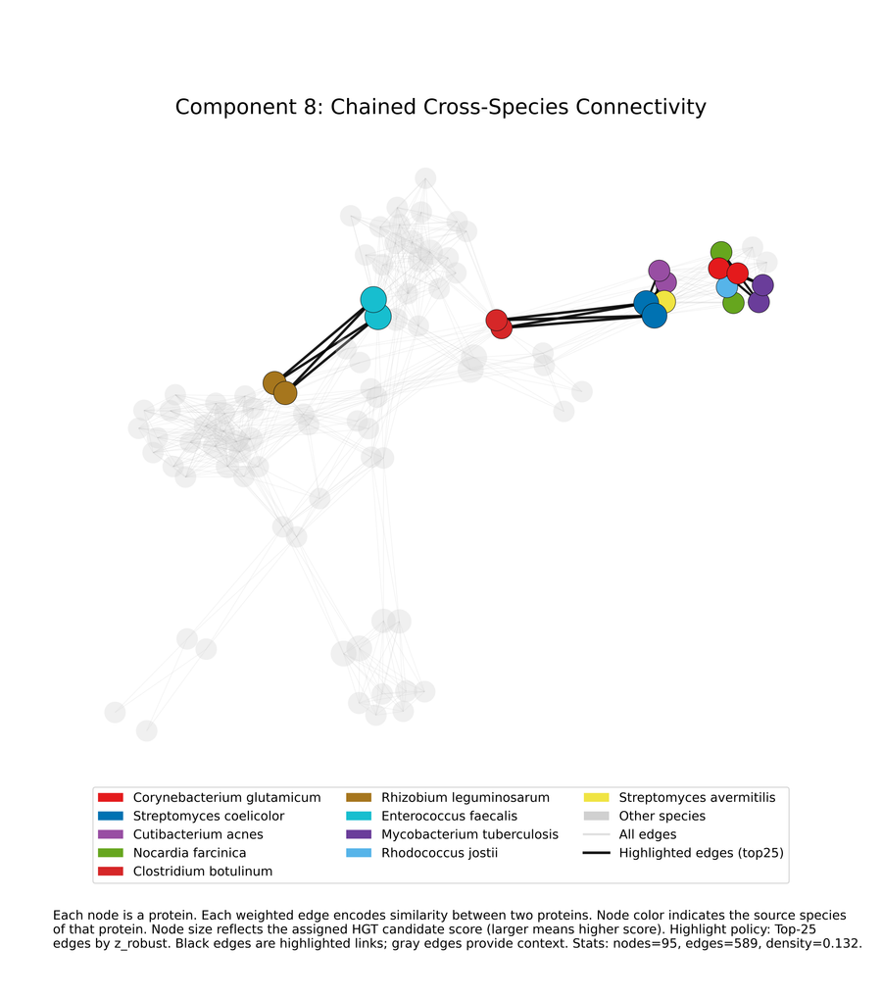
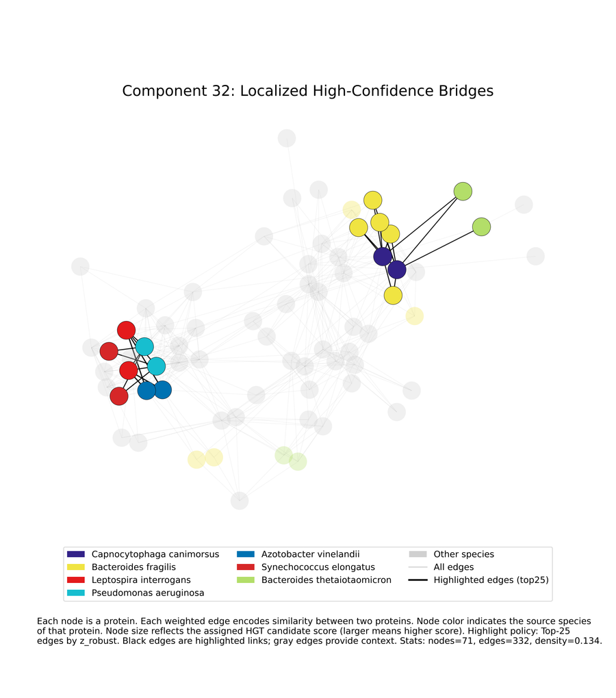

<picture>
  <source media="(max-width: 600px) and (prefers-color-scheme: dark)" srcset="assets/hero-mobile-dark.svg">
  <source media="(max-width: 600px)" srcset="assets/hero-mobile-light.svg">
  <source media="(prefers-color-scheme: dark)" srcset="assets/hero-dark.svg">
  
</picture>

**GraFT ranks horizontal gene transfer (HGT) candidates from bacterial proteomes
using protein-similarity graphs.** It looks for proteins that are unusually
similar across species relative to each species pair's background, then uses
graph structure to prioritize candidates for biological follow-up.

[Read the paper](paper/main.pdf) · [Method and implementation](METHOD.md) · [Reproduce the analysis](REPRODUCE.md)

## The idea

1. **Build the graph:** compare proteins through k-mer overlap and Jaccard
   similarity, without sequence alignment or phylogenetic reconstruction.
2. **Find unusual similarities:** normalize edges against each species pair's
   background using robust statistics.
3. **Rank candidates:** combine similarity anomalies with local graph structure
   and component context.

The saved analysis covers **50 species, 37,421 proteins, 92,790 edges, and 5,262
connected components**. These signals identify candidates; they do not establish
a transfer event on their own.

## Example components

Protein-similarity graphs from the saved analysis. Colors distinguish species,
node size reflects candidate score, and black edges highlight unusually strong
similarities. Click a preview for the full-resolution figure.

<table width="100%">
<tr><th width="33%">Component 5</th><th width="33%">Component 8</th><th width="33%">Component 32</th></tr>
<tr><td width="33%" valign="top"><a href="artifacts/updated_plots/topk/component_5.png"></a></td><td width="33%" valign="top"><a href="artifacts/updated_plots/topk/component_8.png"></a></td><td width="33%" valign="top"><a href="artifacts/updated_plots/topk/component_32.png"></a></td></tr>
</table>

[Output formats and plotting commands →](artifacts/README.md)

## Run on the saved graph

With Python 3.9 or newer, run from the repository root:

```sh
python -m pip install -e .
python -m graft.pipeline --in_edges golden/reference_inputs/edges_PRUNED_JACCARD_92790.tsv --out_dir tmp/quickstart --no_betweenness
```

This uses the tracked graph, requires no RefSeq download, and writes ranked
candidates and feature tables to `tmp/quickstart`. It uses the faster
no-betweenness mode; its ranking differs from the betweenness-on analysis.

For both analysis modes, report generation, and fresh-data runs, see the
[reproduction guide](REPRODUCE.md). Regression checks are documented under
[tests](tests/README.md).

---

[Citation](CITATION.cff) · [GPL v3.0](LICENSE)
